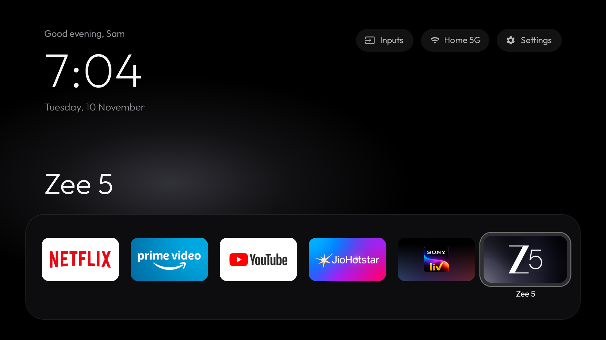
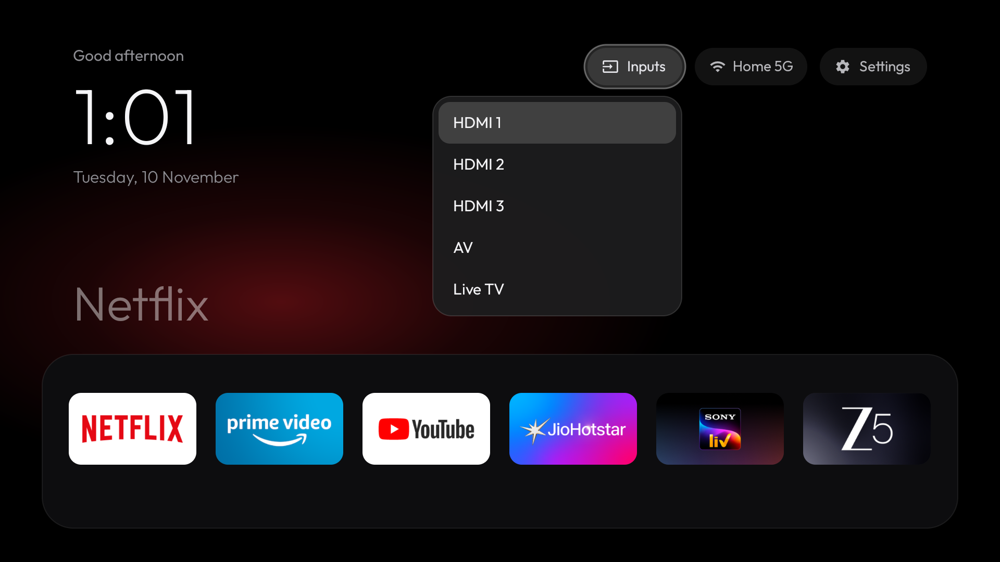
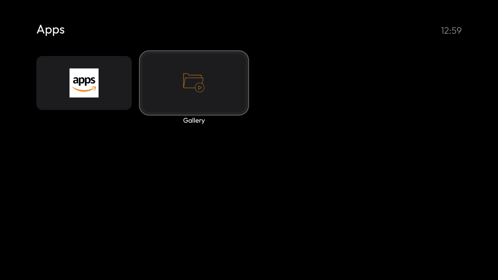
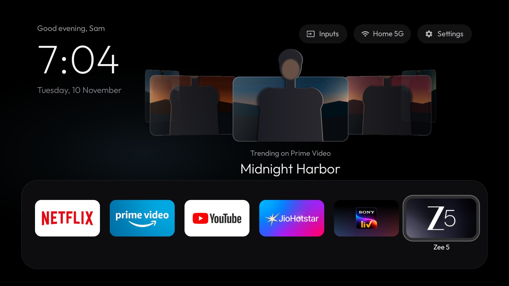
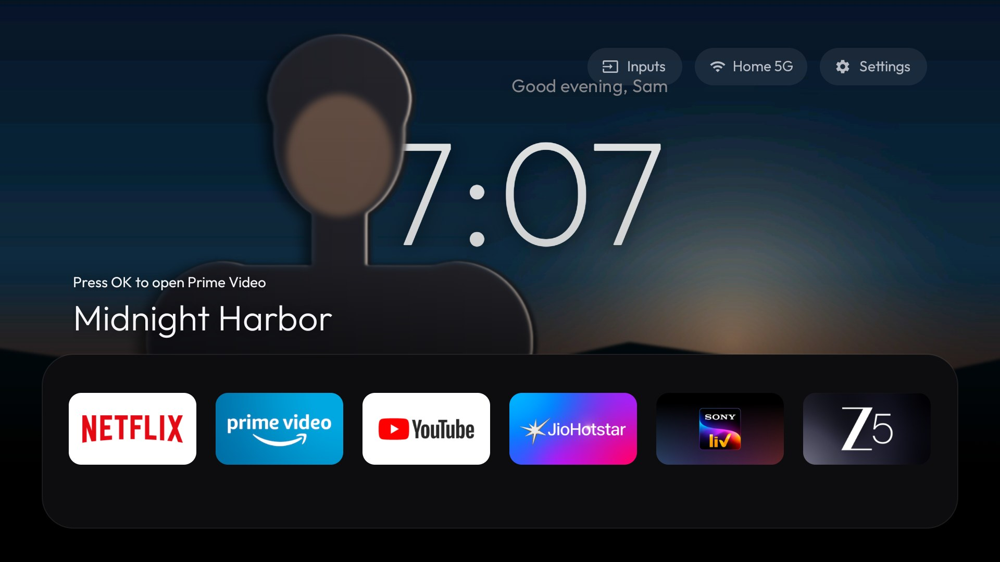
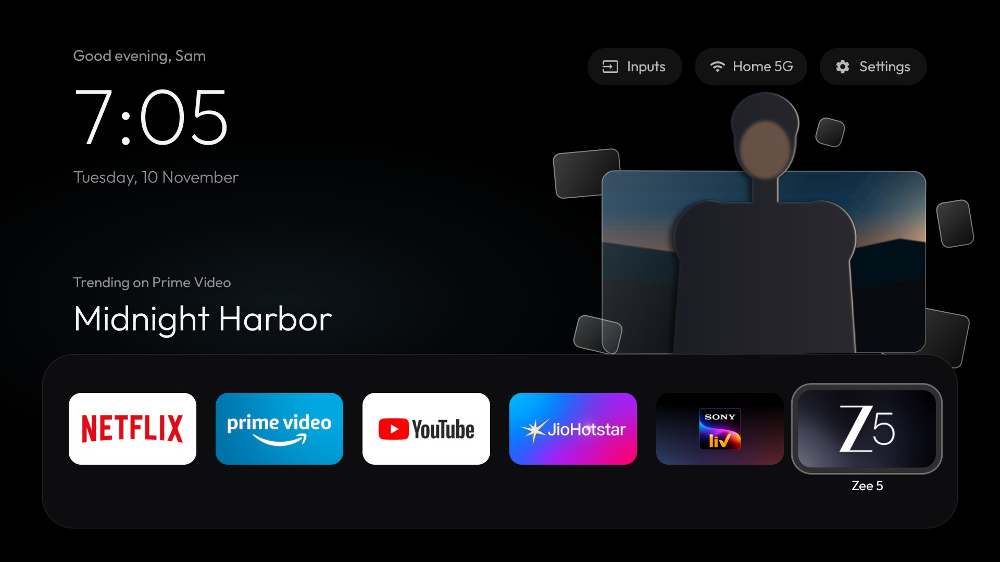
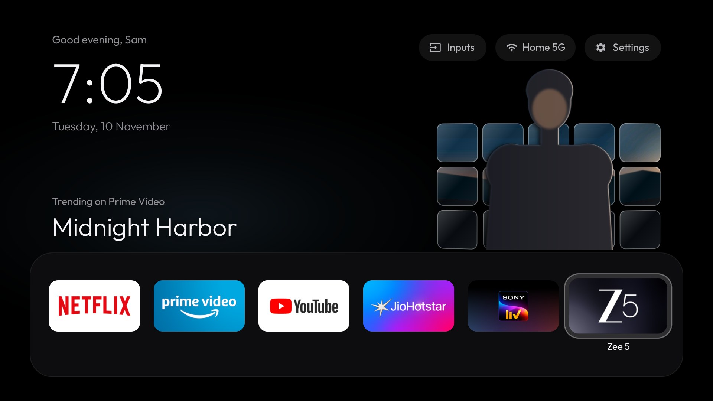
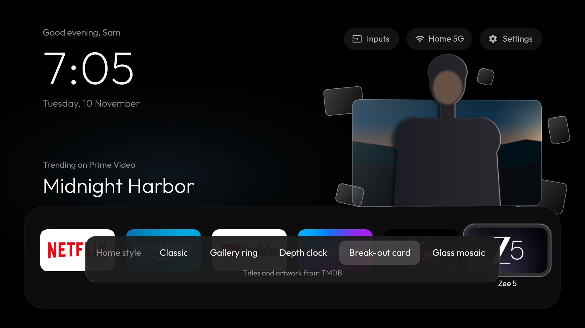

# Glass Home for Fire TV

A minimal home screen and a reversible debloat for a Xiaomi Fire TV
(model L43MB-FPIN, 2025; Fire OS 8.1.8.5, Android 11).



## Features

- Pitch-black home screen with a personal greeting ("Good evening, Sam", taken from the
  TV's name), a large thin clock and the date set in Outfit.
- Frosted pills for **Inputs**, **Wi-Fi** (shows the network name) and **Settings**.
- A dock band with your main apps; the focused app's name is shown in large type above it,
  over a soft glow tinted with a colour sampled from the app's banner.
- All other apps in a four-column grid that slides up when you press Down.
- One translucent glass highlight that springs from item to item; the focused tile lifts
  towards you in 3D, catches a brief light sheen and shows its name underneath.
- Five home styles, chosen with the remote's Menu button: Classic, and four styles that show
  this week's trending titles from your apps with the main character cut out so that it
  stands in front of the screen: **Gallery ring** (a turning 3D ring of glass cards),
  **Depth clock** (the character stands in front of a large clock), **Break-out card** (the
  character climbs out of a tilting glass card) and **Glass mosaic** (the artwork splits into
  breathing glass tiles).
- Deterministic D-pad navigation that remembers the last focused tile.
- Lightweight: no blur, no video, no network polling (about 115 MB PSS on the TV).
- Telemetry, advertising and unused preloaded apps disabled; nothing is uninstalled, and a
  single script restores everything.

| Inputs | Apps |
| --- | --- |
|  |  |

| Gallery ring | Depth clock |
| --- | --- |
|  |  |
| **Break-out card** | **Glass mosaic** |
|  |  |

The style screenshots use the generated demo artwork (`featured.bat demo`); with
`featured.bat` the cards show this week's trending titles instead.

## Quick start

Requirements: Windows with Docker Desktop, and the TV on the same network as the PC.
[SETUP.md](SETUP.md) describes the toolchain, an alternative build with mise, and every
file that is downloaded.

1. **Enable ADB debugging on the TV**
   1. Settings > My Fire TV > About: select the TV name seven times until it reports that
      you are a developer.
   2. Settings > My Fire TV > Developer Options: turn **ADB Debugging** on.
   3. Note the IP address under Settings > My Fire TV > About > Network.
2. **Set the TV address**: copy `tv.env.example` to `tv.env` and set `TV_IP`. If the router
   gives the TV a new address later, the scripts find it again by themselves.
3. **Run `glasshome.bat`** (double-click). The first run builds the toolchain image
   (about 1 GB, once). When the TV asks *Allow USB debugging?*, tick
   *Always allow from this computer* and select OK.

> Fire OS switches ADB Debugging off whenever the TV restarts. Turn it on again before
> running any of the scripts.

## Using the launcher

| Remote button | Action |
| --- | --- |
| Left / Right | Move within the current row; stops at the ends |
| Up / Down | Move exactly one row: top bar, dock, then each row of the apps grid |
| Select | Open the focused app or pill |
| Back | Return to the dock |
| Home | Return to Glass Home; pressing Home on Glass Home returns to the dock |
| Menu (three lines) | Choose the home style: Left/Right previews each style, Select keeps it, Back cancels |

In the featured styles, Up from the dock moves to the featured title: Left/Right changes
title, Select opens the app that streams it. Titles also change by themselves every nine
seconds while nobody is using the remote, and all motion stops while an app is open.

- **Inputs** lists the HDMI ports, AV and Live TV. Fire OS reserves its own input player for
  Amazon-signed apps, so HDMI and AV open in Glass Home's own full-screen player through the
  Android TV input framework; it shows "No signal" when nothing is connected. Back or Home
  returns to the launcher. Live TV opens Amazon's Live TV guide. (The picture itself has not
  yet been checked with a device connected.)
- **Wi-Fi** shows the connected network and opens the network settings.
- **Settings** opens the Fire TV settings.

## How the Home button works on Fire OS

Fire OS always sends the Home button to Amazon's own launcher, and that launcher is
protected: it cannot be disabled and the standard "default home app" setting is ignored.
Glass Home therefore includes a small accessibility service, *Glass Home: Home button*.
As soon as Amazon's home screen appears, the service opens Glass Home with the tile of the
app you just left in focus. Amazon's screen is visible for a fraction of a second.

After a memory-heavy app such as YouTube, Fire OS may have stopped its launcher in the
background. Pressing Home then shows Amazon's loading screen (three dots) for two to three
seconds while it reloads, and Glass Home appears once it has. Fire OS only reports the home
screen after that reload, and it does not pass the Home key to other apps, so this wait
cannot be skipped. At start-up, Fire OS opens Glass Home directly.

Fire TV's Settings screens pass through Amazon's home screen on the way in; the service
recognises this and leaves Settings open. The service only reacts to window changes and does
not read screen content. To turn it off, run `restore.bat` or disable it under
Settings > Accessibility on the TV.

## Customising

### Dock apps and order

```powershell
powershell -ExecutionPolicy Bypass -File scripts\set-dock.ps1 -List
powershell -ExecutionPolicy Bypass -File scripts\set-dock.ps1 com.netflix.ninja com.amazon.firebat com.amazon.firetv.youtube in.startv.hotstar com.onemainstream.sonyliv.android com.zee5.amazon
powershell -ExecutionPolicy Bypass -File scripts\set-dock.ps1 -Default
```

Up to four apps use full-size tiles; with more, the tiles shrink to fit the band (six is a
comfortable maximum). The default dock is defined in
`launcher/app/src/main/java/dev/glasshome/launcher/Prefs.java`.

| App | Package |
| --- | --- |
| Netflix | `com.netflix.ninja` |
| Prime Video | `com.amazon.firebat` |
| YouTube | `com.amazon.firetv.youtube` |
| JioHotstar | `in.startv.hotstar` |
| SonyLIV | `com.onemainstream.sonyliv.android` |
| Zee5 | `com.zee5.amazon` |
| Gallery | `com.amazon.tv.localgallery` |

The Appstore (`com.amazon.venezia`) has no tile but stays installed: apps from Amazon's store
use it in the background for updates and licence checks.

### Name in the greeting

The greeting uses the TV's name (Settings > My Fire TV > About): "SAM's Fire TV" shows
"Good evening, Sam". To use a different name:

```powershell
powershell -ExecutionPolicy Bypass -File scripts\set-name.ps1 Sam
powershell -ExecutionPolicy Bypass -File scripts\set-name.ps1 -Default
```

### Home styles and featured titles



Press Menu (three lines) on the home screen to open the style picker shown above.

The featured styles need titles, which are prepared on the PC and copied to the TV; the TV
itself downloads nothing and does no image processing. `featured.bat`:

1. asks [TMDB](https://www.themoviedb.org/) for this week's trending films and series and
   keeps those that stream in India on the dock's apps (Netflix, Prime Video, JioHotstar,
   Zee5, SonyLIV), using artwork without text;
2. cuts the main character out of each picture with the ISNet background-removal model
   (on the PC's CPU, in Docker) and blends it so that it reads as a separate layer: a
   shallow depth of field behind it, cleaned edges, light wrap from the scene, a rim light
   on the side facing the scene's light, and a soft contact shadow;
3. copies the result to the TV (`scripts\push-featured.ps1`).

One-time setup: create a free account at themoviedb.org, then under *Settings > API* request
an API key (choose *Developer*), copy the **API Read Access Token** and add it to `tv.env`:

```
TMDB_TOKEN=eyJ...
```

Then run `featured.bat` whenever you want new titles (about two minutes for eight titles).
`featured.bat demo` prepares generated demo artwork instead and needs no account. To choose
the style from the PC, or to remove the titles:

```powershell
powershell -ExecutionPolicy Bypass -File scripts\set-style.ps1 ring    # classic, ring, depth, breakout, mosaic
powershell -ExecutionPolicy Bypass -File scripts\push-featured.ps1 -Remove
```

The artwork belongs to its owners and is used here for personal viewing; it stays in the
ignored `featured/` folder on the PC and in the launcher's own storage on the TV, and is never
committed. Titles whose artwork has no clear main character are shown without the pop-out
effect.

### Wallpaper

```powershell
powershell -ExecutionPolicy Bypass -File scripts\set-wallpaper.ps1 C:\path\to\image.jpg
powershell -ExecutionPolicy Bypass -File scripts\set-wallpaper.ps1 -Remove
```

JPEG, PNG and WebP are supported. The image fills the screen and is dimmed slightly so text
stays readable. Without a wallpaper the background is pure black.

### Updating the launcher

Run `glasshome.bat` again; settings are kept. Updates install in place because every build is
signed with `launcher/debug.keystore`, which is created on the first build and is not
committed. If that file is lost, uninstall the app once
(`adb uninstall dev.glasshome.launcher`) before installing a new build.

## Debloat

The package list lives in [`config/debloat-packages.txt`](config/debloat-packages.txt).
Packages are disabled with `pm disable-user --user 0`; nothing is uninstalled.

| Group | Packages |
| --- | --- |
| Telemetry and analytics | Xiaomi analytics, Amazon automatic content recognition (ACR), telemetry emitter, loggers, performance collectors, Wi-Fi metrics |
| Advertising and recommendations | Advertising ID service, sponsored content, autoplay previews, demo content, shopping, recommendation rows |
| Background services | Release notes, tutorials, Early Access, set-up services for other Amazon devices |
| Preloaded apps | Games hub, website shortcuts, Amazon Photos, European satellite operator apps, AirPlay, Alexa Smart Home, Amazon Kids, Amazon Luna, Amazon Music, Silk browser |
| Streaming apps not in use | JioCinema, Amazon miniTV |
| European broadcast services | Vewd HbbTV and Freeview Play, UK MHEG (not used in India) |
| System updates | Update helpers; Fire OS no longer installs new versions, so the setup stays as it is |
| Amazon extras | Amazon screensaver (the basic Android screensaver takes over), Hedwig notification service |
| Casting and mirroring | Casting from phone apps (YouTube, Netflix, Prime Video) and screen mirroring |
| Alexa and smart home | Alexa voice search, alerts and calling, Matter smart-home services |

In total 60 packages are disabled. Fire OS protects a few packages from being disabled
(device metrics, crash manager, log manager, usage statistics, ad deep-linking, the two OTA
update services and the help app). These are blocked from running in the background instead.

What this means in daily use:

- The remote's microphone button no longer works (Alexa is off).
- Phones cannot cast to the TV or mirror their screen.
- Fire OS does not update itself, which also means no new security patches. To allow updates
  again, remove the "System updates" lines from the list and re-enable the packages
  (see below).

Deliberately kept: remote pairing, keyboard, HDMI and Live TV services, Wi-Fi, the Appstore
and app sign-in, and the system help pages in Settings.

### Re-enable a single app

```powershell
tools\platform-tools\adb.exe connect 192.168.1.50:5555
tools\platform-tools\adb.exe shell pm enable --user 0 com.amazon.cloud9
```

If the package is listed in `config/debloat-packages.txt`, remove it from the list so that
`debloat.ps1` does not disable it again.

### Disable another app or re-apply the list

Add the package to `config/debloat-packages.txt`, then run (use `-WhatIf` to preview):

```powershell
powershell -ExecutionPolicy Bypass -File scripts\debloat.ps1
```

Run the same command after a factory reset or if a Fire OS update re-enables packages.

### Restore everything

Run `restore.bat`. It re-enables every package disabled since the baseline backup, lifts the
background restrictions, turns off the Home button helper, makes Amazon's launcher the home
screen again and uninstalls Glass Home. Options:

```powershell
powershell -ExecutionPolicy Bypass -File scripts\restore.ps1 -WhatIf        # preview only
powershell -ExecutionPolicy Bypass -File scripts\restore.ps1 -KeepLauncher  # keep Glass Home installed
```

The baseline backup (`backup\BASELINE`) holds the package lists, system properties and all
settings as they were before any change.

## Scripts

| Script | Purpose |
| --- | --- |
| `glasshome.bat` | One-click build in Docker and install on the TV |
| `featured.bat` | Prepare this week's featured titles and copy them to the TV |
| `restore.bat` | Undo the debloat and remove Glass Home |
| `scripts/push-featured.ps1` | Copy prepared titles to the TV, or remove them |
| `scripts/set-style.ps1` | Choose the home style from the PC |
| `scripts/install.ps1` | Install a built APK using the host's adb |
| `scripts/find-tv.ps1` | Show the TV's address, finding the TV again if it has changed |
| `scripts/set-dock.ps1` | List apps, set or reset the dock |
| `scripts/set-wallpaper.ps1` | Set or remove the wallpaper |
| `scripts/debloat.ps1` | Apply `config/debloat-packages.txt` |
| `scripts/backup.ps1` | Snapshot packages, properties and settings |
| `scripts/restore.ps1` | Restore script used by `restore.bat` |
| `scripts/get-adb.ps1` | Download Google's platform-tools into `tools/` |
| `scripts/setup-sdk.ps1`, `scripts/build.ps1` | Host build with mise (see SETUP.md) |

## Troubleshooting

**The scripts cannot reach the TV.** Check that the TV is on and that ADB Debugging is
enabled; Fire OS turns it off after every restart.

**The TV has a new IP address.** Nothing on the TV depends on its address; only the scripts
on the PC use `TV_IP` in `tv.env`. The first time a script reaches the TV it saves the TV's
network card ID (MAC address) as `TV_MAC` in `tv.env`. If the router later gives the TV a
different address, every script notices that the TV no longer answers, finds it on the home
network by that ID, and updates `TV_IP` by itself. `scripts\find-tv.ps1` does only this step
and prints the address. To keep the address fixed, reserve it for the TV in the router's
DHCP settings.

**The connection drops for a few seconds at a time.** On some home networks the router
occasionally stops passing traffic between Wi-Fi devices. The scripts reconnect
automatically. Restarting the TV or the router clears it; for a permanent fix, run this once
in an administrator command prompt (replace the address and MAC with your TV's):

```bat
netsh interface ipv4 add neighbors "Wi-Fi" 192.168.1.50 aa-bb-cc-dd-ee-ff
```

Undo with `netsh interface ipv4 delete neighbors "Wi-Fi" 192.168.1.50`. If the TV's address
changes later, delete the entry and add it again with the new address.

**Home opens Amazon's home screen.** The Home button helper is off. Run `glasshome.bat` or
`scripts\install.ps1` again to re-enable it.

**The Wi-Fi pill shows "Wi-Fi" instead of the network name.** Android only reveals the network
name to apps with location permission:
`adb shell pm grant dev.glasshome.launcher android.permission.ACCESS_FINE_LOCATION`.

**Diagnostics.** Enable the launcher's log with
`adb shell setprop log.tag.GlassHome DEBUG`, then read it with `adb logcat -s GlassHome`.

## Project layout

```
config/               Debloat package list
docker/               Toolchain image, container build and install scripts
docker/featured/      Featured-titles image and script (TMDB, ISNet cut-outs, blending)
docs/images/          Screenshots
launcher/             Android project (Java, AndroidX RecyclerView)
scripts/              PowerShell scripts for the TV and host builds
glasshome.bat         One-click build and install
featured.bat          One-click featured titles
restore.bat           One-click restore
mise.toml             Pinned toolchain for host builds
tv.env.example        TV address and TMDB token template
backup/, tools/, dist/, shots/, featured/   Local only (not committed)
```

## Credits

- [Outfit](https://github.com/Outfitio/Outfit-Fonts) typeface, copyright The Outfit Project
  Authors, licensed under the SIL Open Font License 1.1
  (`launcher/app/src/main/assets/fonts/OFL.txt`).
- Pill icons from Google's Material Icons, licensed under the Apache License 2.0.
- AndroidX RecyclerView, licensed under the Apache License 2.0.
- Featured titles and artwork from [TMDB](https://www.themoviedb.org/). This product uses the
  TMDB API but is not endorsed or certified by TMDB.
- Character cut-outs use the ISNet (DIS) general-use model as published by the
  [rembg](https://github.com/danielgatis/rembg) project, run with ONNX Runtime (MIT).

## Licence

Released under the MIT License (see `LICENSE`). Third-party components keep their own
licences, listed under Credits.
